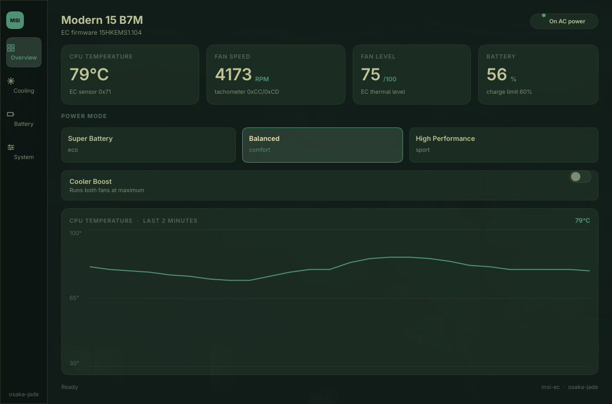

# msi-center-rust

A native Linux app that does what MSI Center does on Windows, for the MSI
Modern 15 B7M (board MS-15HK) — same dark, card-based look, but one small Rust
binary instead of a .NET/WPF app, three services and a webview.



No Windows support and no Windows code is reused: the hardware is driven
through the in-tree `msi-ec` kernel driver plus battery/LED sysfs.

## Install

**Arch / Omarchy** — one command installs the app package, the matching
`msi-ec` DKMS source, the permissions, and (when Omarchy is detected) the bar
widget:

```sh
curl -fsSL https://github.com/tanmaypanda-14/msi-center-rust/releases/latest/download/install.sh | sudo bash
```

What it does:

- downloads the latest release packages and verifies `SHA256SUMS`
- installs `msi-center` and `msi-ec-dkms` (the DKMS source is owned by a
  package, so pacman can cleanly upgrade or remove it)
- adds the invoking user to `msi-ec`
- removes older `/etc` copies of the permission files, enables
  `msi-ec-perms.service`, and applies the grant immediately
- updates `~/.config/omarchy/plugins/tanmay.msi-power` when Omarchy is present

Use `--no-widget` to skip the widget, `--no-driver` when you install
`msi-ec-dkms` yourself, or `--dry-run` to download and verify without
changing anything:

```sh
url=https://github.com/tanmaypanda-14/msi-center-rust/releases/latest/download/install.sh
curl -fsSL "$url" | sudo bash -s -- --no-widget
curl -fsSL "$url" | bash -s -- --dry-run
```

If you prefer packages by hand, every release also carries the `.pkg.tar.zst`
files:

```sh
sudo pacman -U msi-center-0.2.3-2-x86_64.pkg.tar.zst msi-ec-dkms-0.13-1-any.pkg.tar.zst
sudo usermod -aG msi-ec $USER # then log out and back in
```

**Any distro** — a single binary in a tarball (see
[Releases](https://github.com/tanmaypanda-14/msi-center-rust/releases)):

```sh
tar xf msi-center-0.2.3-x86_64-linux.tar.gz
sudo install -Dm755 msi-center-0.2.3-x86_64-linux/msi-center /usr/local/bin/msi-center
```

Either way, the machine also needs the **`msi-ec` kernel driver** (it cannot be
bundled — kernel modules are built per kernel), and the permission setup from
**[INSTALL.md](INSTALL.md)** if you install from the tarball.

```sh
msi-center --snapshot      # should print backend msi-ec, not mock
```

## Budgets

| Metric | Target | Current |
| --- | --- | --- |
| Binary (stripped, LTO) | < 10 MB | 10.1 MB |
| Idle RSS | < 30 MB | ~21 MB |
| Processes | 1 | 1 |
| Refresh | 1 s poll, redraw on change | ✓ |

## Layout

```
docker/Dockerfile      build image: Rust + Slint build deps only
docker-compose.yml     dev container; host /sys mounted read-only
crates/core            domain model + MsiControl seam + msi-ec backend
crates/app             Slint UI (ui/main.slint) + wiring
re/                    reverse-engineering notes on MSI Center 2.0.75.0
```

## Quick start

```sh
make build     # build the image
make check     # cargo check (container)
make test
make release   # ./target/release/msi-center
make run       # build in the container, run on the host
```

The GUI has to run on the host: it needs your Wayland session and the real EC.
Builds happen in the container; `target/` and `.cargo-home/` are bind-mounted
project directories, so nothing is installed on the host.

### Dependencies

The app expects the `msi_ec` kernel module and the udev rule that makes its
attributes writable by the `msi-ec` group (see `omarchy-msi-power`):

```
/sys/devices/platform/msi-ec/{shift_mode,fan_mode,cooler_boost,fw_version,…}
/sys/class/power_supply/BAT1/charge_control_end_threshold
/sys/class/leds/msiacpi::kbd_backlight/
```

If the driver is missing the app falls back to a mock backend so the UI still
runs.

## Headless use

```sh
msi-center --snapshot            # print everything the UI shows
msi-center --set fan=silent      # shift=eco|comfort|sport, fan=auto|silent|advanced
msi-center --set cooler=on       # battery=60..100, kbd=N
msi-center --set fnswap=on       # swap Fn/Win (off = standard layout)
msi-center --set webcam=on       # EC-level camera block
msi-center --page 2              # open on a given page (0-3)
```

## Hardware notes

* Fn/Win swap is one EC bit (`0xBF` bit 4, inverted on this board); "swapped"
  means the Win key sits left of Fn. The driver exposes both `fn_key` and
  `win_key`, so the app reads `win_key` and writes its opposite.
* The driver only loads if the EC firmware string matches its whitelist
  exactly. `15HKEMS1.104` is supported; a newer BIOS firmware may need a newer
  driver. The full board analysis is in
  [`re/msi-ec-ms15hk.md`](re/msi-ec-ms15hk.md).
* Fan RPM is not `cpu/realtime_fan_speed` (that is the EC's thermal level at
  `0x71`). RPM comes from the tick counter at `0xCC/0xCD`, `480000 / ticks`,
  read from the debugfs EC image; without read access to it the RPM row shows
  `--` instead of a wrong number.
* Charge limit is the standard `charge_control_end_threshold` (currently
  owned by root on this laptop — the udev rule needs to cover it).
* Keyboard backlight and webcam block are exposed by `msi-ec` / `msiacpi`.

## Licence

MIT — see [LICENSE](LICENSE).

## Legal

Interoperability work on software the author owns. No MSI code, assets or
branding is copied into this app; the UI only imitates the layout language.
